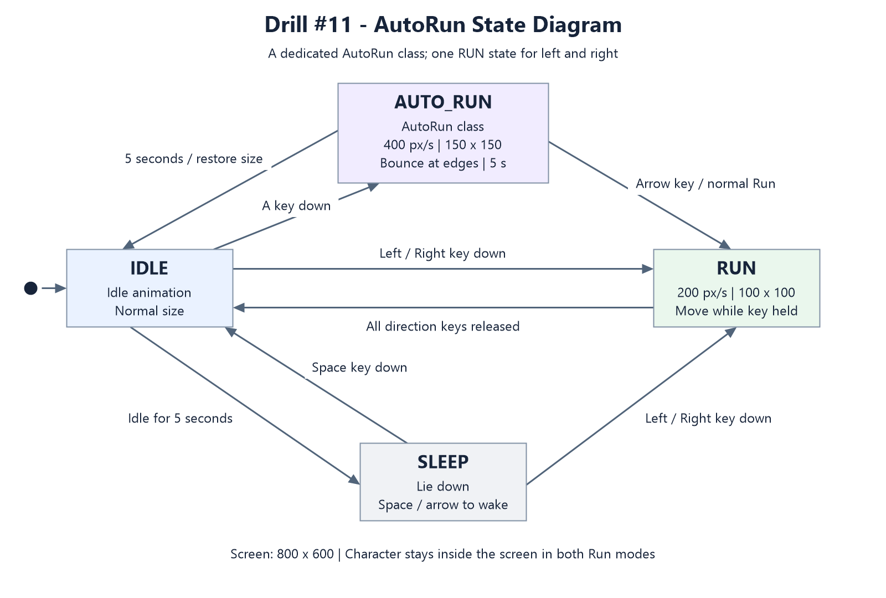
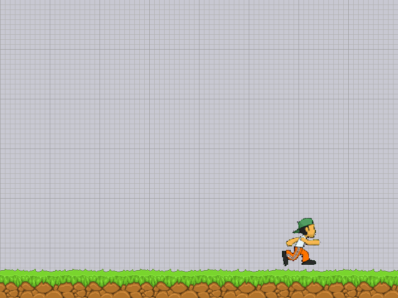
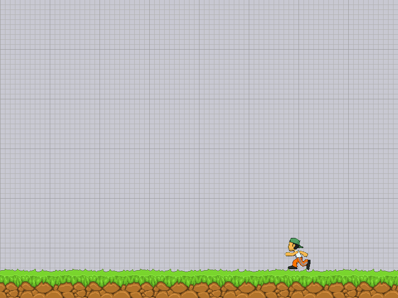
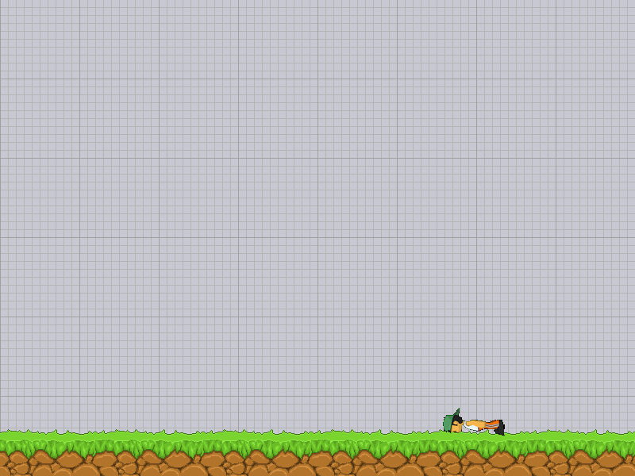

# Drill #11 — 소년 자동 무적 런(AutoRun)

Idle/Run/Sleep 소년 컨트롤러에 별도의 **`AutoRun` 상태 클래스**를 추가한 2D 게임 프로그래밍 실습입니다.

## 설치와 실행

Python 3.13 환경에서 다음 명령을 실행합니다. 게임 창을 표시할 수 있는 데스크톱 환경이 필요합니다.

```bash
git clone https://github.com/junhwijunhwi/2DGP-2023180015-Drill11-AutoRun.git
cd 2DGP-2023180015-Drill11-AutoRun
python -m pip install -r requirements.txt
python main.py
```

Windows에서 `python` 명령을 찾지 못하면 `py -3.13`을 사용하거나 VS Code에서 설치된 Python 인터프리터를 선택합니다. 실행 파일은 `main.py`입니다.

## 조작

| 입력 | 동작 |
| --- | --- |
| Idle에서 A | AutoRun 시작. A를 떼어도 자동 이동 |
| AutoRun에서 ← / → | AutoRun 취소 후 해당 방향의 일반 Run |
| Idle / Sleep에서 ← / → | 일반 Run 시작 |
| 방향키 모두 해제 | 일반 Run → Idle |
| Sleep에서 Space | Idle로 복귀 |
| Escape / 창 닫기 | 종료 |

- **AutoRun:** 400 px/s, 150×150, 애니메이션 16 FPS, 5초 후 Idle로 복귀.
- **일반 Run:** 200 px/s, 100×100, 애니메이션 8 FPS.
- AutoRun은 진입 직전 바라보던 방향으로 출발하고, 확대된 소년 전체가 화면 안에 머물면서 좌우 끝에서 자동 반사됩니다.
- 방향키로 취소하면 속도와 크기가 즉시 복구됩니다. 양쪽 키를 누르면 마지막으로 누른 방향이 우선합니다.
- Idle에 돌아온 뒤 다시 5초가 지나면 Sleep으로 이동합니다. AutoRun 중 A/Space는 타이머를 재시작하지 않습니다.

## 상태 다이어그램

제출용 이미지 파일: [docs/state_diagram.png](docs/state_diagram.png)



원본: [docs/state_diagram.mmd](docs/state_diagram.mmd). `AutoRun` 클래스의 `enter`, `update`, `exit`, `draw`가 자동 이동 상태의 수명 주기를 담당하고 `transitions`가 상태 전환을 관리합니다.

## 실제 렌더링 예시

아래 이미지는 포함된 코드와 PNG 리소스를 실제 pico2d/SDL 렌더러로 그려 저장한 화면입니다. 테스트용 가상 시계로 상태를 재현했습니다.

| Idle | AutoRun |
| --- | --- |
|  |  |

| 일반 Run | Sleep |
| --- | --- |
|  |  |

## 검증

```bash
python -m unittest discover -s tests -v
python tools/render_smoke.py
```

첫 명령은 19개 동작 검증을 실행합니다. 두 번째 명령은 화면을 열지 않는 SDL 소프트웨어 렌더링으로 네 상태의 PNG를 재생성합니다. 테스트는 실제 `transitions` 상태 머신을 사용하며 그래픽과 시계만 대체합니다. 검증 내역은 [docs/VALIDATION.md](docs/VALIDATION.md)에 정리했습니다.

Windows에서는 상태도 PNG를 다음과 같이 다시 생성할 수 있습니다.

```powershell
powershell -ExecutionPolicy Bypass -File tools/generate_state_diagram.ps1
```

## 파일 구성과 출처

- `PRD.md`: 개발 기획, 요구사항, 인수 조건, 검증 계획.
- `main.py`, `boy.py`, `grass.py`: 게임 실행 코드와 `AutoRun` 상태 클래스.
- `assets/animation_sheet.png`, `assets/grass.png`: 실행에 필요한 이미지. 기존 2DGP 수업 프로젝트 `Labs/LEC12_CharacterController`에서 가져왔습니다.
- `requirements.txt`: 실행 의존성.
- `tests/`, `tools/`, `docs/`: 검증 코드, 상태도·실행 이미지 및 문서.

수업 리소스를 사용한 학습 과제이며 해당 리소스에 새로운 라이선스를 부여하지 않습니다. 개발에는 AI 도구(Codex)를 사용했습니다. 수업의 별도 AI 사용 제출 지침도 확인해야 합니다.

## 제출 주소

e-Class에는 다음 **`.git`으로 끝나는 저장소 주소**를 제출합니다. e-Class 업로드 및 마감 시각 확인은 학생 본인이 수행합니다.

```text
https://github.com/junhwijunhwi/2DGP-2023180015-Drill11-AutoRun.git
```
